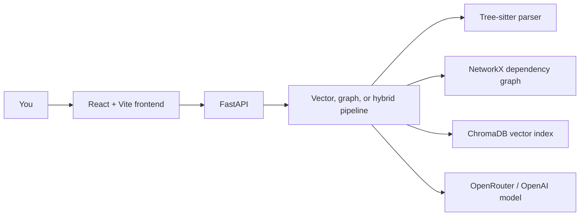

<div align="center">

# 🧠 Axon

### Hybrid RAG for codebase comprehension

Ask questions about a codebase and explore how its components connect, using semantic retrieval and AST-derived dependency graphs.


</div>

---

## ✨ What it does

Axon combines code structure with natural-language search to help you understand a repository.

| Capability | Description |
| --- | --- |
| 🌳 **AST parsing** | Uses Tree-sitter to extract functions, classes, and call relationships. |
| 🕸️ **Dependency graphs** | Builds NetworkX graphs for exploring code connections and impact. |
| 🔎 **Vector retrieval** | Creates semantic indexes and retrieves relevant code for a question. |
| 🧩 **RAG modes** | Includes vector, graph, and hybrid query pipelines. |
| 💻 **Web interface** | React frontend for selecting repositories, asking questions, and viewing graph data. |

> **Project status:** The hybrid retrieval pipeline is still being developed. Results may vary across repositories and query modes.

## 🏗️ How the pieces fit together



## 🚀 Run locally

### 1. Start the API

From the repository root, create a virtual environment and install Python dependencies:

```powershell
python -m venv venv
.\venv\Scripts\Activate.ps1
pip install -r requirements.txt
```

Create a free API key at [OpenRouter](https://openrouter.ai/keys), copy `.env.example` to `.env`, then set the provider and key in that root `.env` file:

```env
AI_PROVIDER=openrouter
OPENROUTER_API_KEY=your_openrouter_api_key
CHAT_MODEL=openrouter/free
EMBEDDING_MODEL=liquid/lfm-2.5-embedding-350m:free
```

The OpenRouter free tier has request limits and upstream free-model availability can vary. Axon uses a separate Chroma collection for each embedding model. The free embedding model has a 512-token input limit, so Axon splits long code chunks before indexing. Rebuild the index after changing the embedding model. The current LFM free embedding listing says requests and embeddings may be retained and used to train Liquid models; use public/non-sensitive code unless that policy is acceptable to you.

To use OpenAI instead, set `AI_PROVIDER=openai`, `OPENAI_API_KEY`, `CHAT_MODEL=gpt-4o-mini`, and `EMBEDDING_MODEL=text-embedding-3-small`. OpenAI API usage is billed separately from ChatGPT subscriptions.

Then run the API:

```powershell
uvicorn api:app --reload --port 8000
```

The API health endpoint is available at `http://localhost:8000/`.

### 2. Start the frontend

In a second terminal:

```powershell
cd frontend
npm install
npm run dev
```

The frontend uses `http://localhost:8000` by default. To point it at another API, set `VITE_API_URL` in the frontend environment.

## ☁️ Deployment

Deployment configuration is included for a separate frontend and API:

- **Frontend:** Import the repository into Vercel and set the project root to `frontend`. Set `VITE_API_URL` to the deployed API URL.
- **API:** Use the root `render.yaml` blueprint on Render. Set `OPENROUTER_API_KEY` and set `FRONTEND_ORIGINS` to the deployed Vercel origin.

## 📁 Repository map

```text
api.py                 FastAPI application
cli.py                 Command-line entry point
src/ast_parser/        Tree-sitter parsing
src/graph/             Dependency graph building and visualization
src/retrieval/         Vector and graph retrieval
src/rag/               Vector, graph, and hybrid pipelines
src/vector/            Vector index creation
frontend/              React + Vite application
FINAL TESTING/         Evaluation reports and outputs
```

## 🧪 Experiments and commands

See [`project_commands.txt`](project_commands.txt) for parser, graph, indexing, retrieval, and pipeline commands. Evaluation reports are in [`FINAL TESTING/`](FINAL%20TESTING/).

## 🔐 Configuration

Keep API keys in local environment files or your hosting provider's secret settings. Environment files are ignored by Git.
